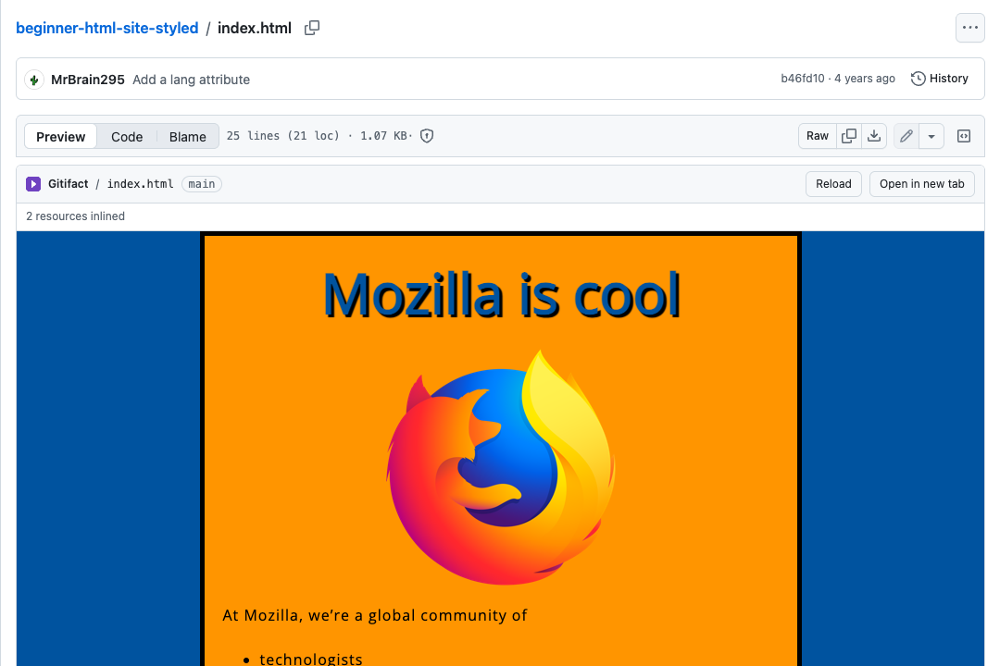
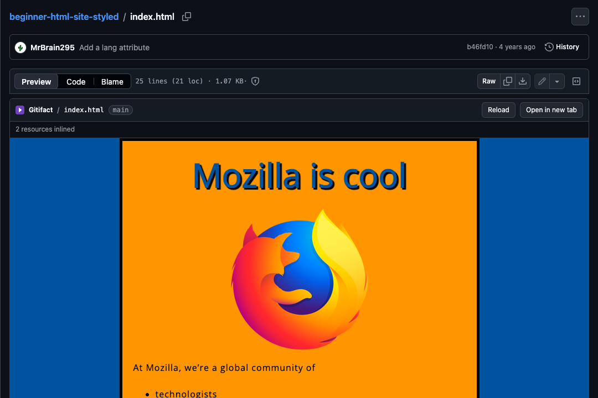

# Gitifact

**Turn GitHub HTML files into live artifacts.**

Gitifact is a Chrome extension that adds a **Preview** tab to HTML files on GitHub. Click it and the
file is rendered as a real web page, right inside the GitHub file view, without downloading anything
or deploying to GitHub Pages. Relative CSS, images and JavaScript from the same repository are
resolved automatically.

| Light mode | Dark mode |
| --- | --- |
|  |  |

## Features

- **Preview tab** next to GitHub's own *Code | Blame* control on any `.html` / `.htm` blob page.
  The preview opens automatically when an HTML file is shown; click *Code* to see the source.
- **Resource resolution**: relative and root-relative `<link rel=stylesheet>`, `<script src>`, ``,
  `srcset`, `<video>`/`<audio>`/`<source>`, nested `<iframe>`, CSS `url()` and `@import` are fetched
  from the same repository and ref and inlined.
- **Branches, tags and commits**, including branch names containing `/`.
- **Private repositories** work when you are signed in to GitHub in the same browser: files are
  fetched through `github.com/…/raw/…` with your session, no token to configure.
- **Sandboxed rendering**: repository content never runs in the GitHub page or in the extension's
  own origin (details under [Security](#security)).
- **JavaScript runs** inside the sandbox, so interactive pages work as they would on a web server.
- **External resources** (CDNs, web fonts, remote images) are loaded over `https:`.
- Resizable height, Reload, Open in new tab.
- Follows GitHub's client-side navigation and light/dark/auto color modes.
- Error and warning reporting: missing files, blocked external resources, script errors.

## Install (unpacked, for development or until the Web Store listing is live)

1. Build the extension (requires Node.js 20+):

   ```sh
   npm install
   npm run build
   ```

2. Open `chrome://extensions` in Chrome.
3. Turn on **Developer mode** (top right).
4. Click **Load unpacked** and select the `dist/` folder of this repository.
5. Open any HTML file on GitHub, for example
   <https://github.com/mdn/beginner-html-site-styled/blob/main/index.html>, and click **Preview**.

After changing the source, run `npm run build` again and press the reload icon on the extension's
card in `chrome://extensions`.

## Usage

- **Preview / Code / Blame**: opening an HTML file shows the rendered page immediately. Click *Code*
  or *Blame* to go back to GitHub's views, and *Preview* to render again.
- **Reload**: fetches the file and its resources again (useful after pushing a change; GitHub's raw
  CDN caches for up to five minutes).
- **Open in new tab**: opens the same preview as a full browser tab.
- **Resize**: drag the handle under the preview to change its height. The height is remembered.
- **Scripts**: inline scripts, `<script src>` from the repository and inline event handlers run
  inside the sandbox. `https:` resources such as CDN scripts, Google Fonts or remote images are
  loaded; `http:` resources are blocked and listed under *resources could not be loaded*.
- **Links**: links to other HTML files in the repository navigate within the preview; links to other
  repository files open the file on GitHub in a new tab.

## How it works

```
github.com page ──content script──▶ adds the Preview tab, embeds <iframe src="chrome-extension://…/preview.html">
                                                 │
                 preview.html (extension page) ──┤ asks the service worker for files
                                                 │ rewrites the HTML (inlines resources, injects a CSP)
                                                 ▼
                 sandbox.html (manifest "sandbox" page, opaque origin, no extension APIs)
                                                 │ postMessage({type:'gitifact:render', html})
                                                 ▼
                 <iframe sandbox srcdoc="…">  ◀── the repository's HTML renders here
```

Fetching goes through `raw.githubusercontent.com`, anonymously. If that returns 404 the service worker
retries via `https://github.com/{owner}/{repo}/raw/{ref}/{path}` with the browser's GitHub cookies;
for repositories the signed-in user can read, GitHub redirects to a short-lived tokenised raw URL.
`raw.githubusercontent.com` serves every file as `text/plain` with
`X-Content-Type-Options: nosniff`, so stylesheets and scripts cannot be referenced by URL; instead the
rewriter (`src/shared/resolve.ts`) fetches them through the service worker and inlines them as
`<style>`/`<script>` elements or `data:` URLs. The same is done for images, fonts and media, and
recursively for `url()` / `@import` inside CSS and for nested repository iframes. Everything else
(absolute URLs to other hosts) is left untouched and governed by the injected Content Security Policy.

The ref and path are taken from the URL. Because branch names may contain `/`, the content script
cross-checks the candidates against GitHub's branch picker and page title. If that is still ambiguous
the service worker probes each candidate on `raw.githubusercontent.com` until one exists.

## Security

Repository HTML and JavaScript are treated as untrusted code.

- The HTML is never injected into the GitHub page. It is rendered inside a sandboxed `<iframe>`
  (`sandbox="allow-scripts allow-modals"`, never `allow-same-origin`) that itself
  lives inside a Manifest V3 *sandbox page*. The previewed document therefore has an opaque origin:
  no cookies, no Web Storage of GitHub or the extension, no access to `chrome.*` APIs, no DOM access
  to any parent frame.
- No `allow-top-navigation`, `allow-popups` or `allow-forms`: the page cannot navigate GitHub, open
  windows or submit forms. `<meta http-equiv="refresh">` and `<base>` are removed.
- A `<meta http-equiv="Content-Security-Policy">` is injected into every previewed document:
  `default-src 'none'` plus `data:`/`blob:` for inlined resources and `https:` for external ones,
  `script-src 'unsafe-inline' 'unsafe-eval' data: blob: https:`, `object-src 'none'`,
  `base-uri 'none'`, `form-action 'none'`. The manifest's sandbox CSP is the upper bound and never
  exceeded.
- `postMessage` is validated at every hop: the sandbox page only accepts `render` messages
  from its parent, relays only `navigate`/`error` messages (with type-checked, length-limited
  fields) from the previewed document, and the preview page only accepts messages whose
  `event.source` is the sandbox frame. The content script only accepts messages from the preview
  frame with the extension's origin, and the preview page only accepts theme/height messages from
  `https://github.com`.
- The service worker only fetches `https://raw.githubusercontent.com/*` (anonymously) and, as a
  fallback for private repositories, `https://github.com/{owner}/{repo}/raw/*` with the browser's
  session cookies, and only on behalf of the extension's own pages. The extension never sees or
  stores a token; the previewed document never gets credentials.
- Permissions: a content script on `https://github.com/*` and host access to
  `https://raw.githubusercontent.com/*` and `https://github.com/*`. No `storage`, `tabs`,
  `scripting` or other permissions.
  The preview height preference lives in the extension page's own `localStorage`.
- The extension pages use `script-src 'self'`; no remote code, no `eval`.

Known residual risks: the previewed page can use CPU, show `alert()` dialogs and make requests to
arbitrary `https:` hosts (with no credentials). This is the same exposure as opening an untrusted
page in an incognito window.

## Known limitations

- **Private repositories** require being signed in to GitHub in the same browser profile; there is
  no token-based access (for example for GitHub Enterprise Server hosts, which are not supported).
- **Resources referenced at runtime are not resolved.** `fetch('./data.json')`, `new Image().src =
  'x.png'` assigned from JavaScript, CSS added by scripts, service workers and web workers cannot
  reach repository files (there is no network path to the repository from the sandbox). Only
  references present in the HTML/CSS at render time are inlined.
- **ES module scripts** with relative `import` statements are not supported (a warning is shown).
  Scripts that read `getAttribute('src')` and compare it with a path will see a `data:` URL instead.
- **Web Storage** inside the preview is an in-memory stand-in that is discarded on reload.
- **Forms cannot be submitted** and links to external sites navigate inside the sandboxed frame.
- **Nested iframes** are inlined two levels deep; `<object>`/`<embed>` are blocked.
- **Size**: individual resources above 15 MB are skipped. Everything is inlined as `data:` URLs, so
  very asset-heavy pages take longer to render.
- `raw.githubusercontent.com` caches files for up to five minutes, so a fresh push may take a moment
  to show up in *Reload*.
- GitHub's DOM is not a public API. The content script relies on the `ul[aria-label="File view"]`
  segmented control, the `#repos-sticky-header` wrapper and the `data-testid="raw-button"` link;
  if GitHub changes these, a fallback button is inserted into the header actions.

## Development

```sh
npm install
npm run watch        # rebuilds dist/ on change (reload the extension in chrome://extensions)
npm run typecheck    # tsc --noEmit
npm test             # unit tests (vitest + jsdom)
npm run test:e2e     # Playwright end-to-end tests (needs `npm run build` and network access)
npm run icons        # regenerate icons from scripts/make-icons.mjs
npm run zip          # build and package gitifact-<version>.zip for the Web Store
```

Layout:

```
public/manifest.json      Manifest V3 (version is copied from package.json at build time)
src/content/              content script + CSS injected into github.com
src/background/sw.ts      service worker: fetch/probe raw.githubusercontent.com
src/preview/              preview page: toolbar, fetch → rewrite → render pipeline
src/sandbox/              sandboxed page that hosts the srcdoc iframe
src/shared/               URL parsing, resource rewriter, CSP, messages
scripts/build.mjs         esbuild-based bundler
test/unit/                vitest unit tests for URL parsing and the rewriter
test/e2e/                 Playwright tests that load dist/ into Chromium
test/fixtures/            HTML/CSS/JS fixtures rendered through the real GitHub UI
```

### Tests

- `npm test` runs the unit tests for GitHub URL parsing, ref disambiguation, path normalisation and
  the HTML/CSS rewriter (inlining, `@import`, `srcset`, `<base>`, CSP injection, link rewriting…).
- `npm run test:e2e` launches Chromium with the built extension and covers: Preview tab injection,
  no tab on non-HTML files, CSS/image rendering on a public repository, JavaScript execution,
  reload, open-in-new-tab, height resize, GitHub dark mode, client-side
  navigation, and sandbox escape attempts (`test/fixtures/malicious.html`: parent/top DOM access,
  cookies, storage, `chrome.runtime`, top navigation, popups, external and github.com fetches,
  form submission, meta refresh).
- `test/e2e/fixtures.spec.ts` renders the fixtures in `test/fixtures/` through GitHub (single file,
  inline CSS, external CSS with `@import`/`url()`, images, scripts, subdirectory, a branch named
  `e2e/slash-branch`, malicious HTML). These tests skip themselves until the fixtures are pushed to
  `github.com/champierre/gitifact` (see `test/fixtures/README.md`; override with
  `GITIFACT_E2E_REPO`, `GITIFACT_E2E_BRANCH`, `GITIFACT_E2E_SLASH_BRANCH`).
- `SCREENSHOTS=1 npx playwright test screenshots` regenerates `docs/screenshots/`.
- Set `HEADED=1` to watch the E2E browser.

## Publishing to the Chrome Web Store

See [docs/STORE.md](docs/STORE.md) for the checklist (listing text, privacy disclosures, permission
justifications, packaging).

## License

MIT
